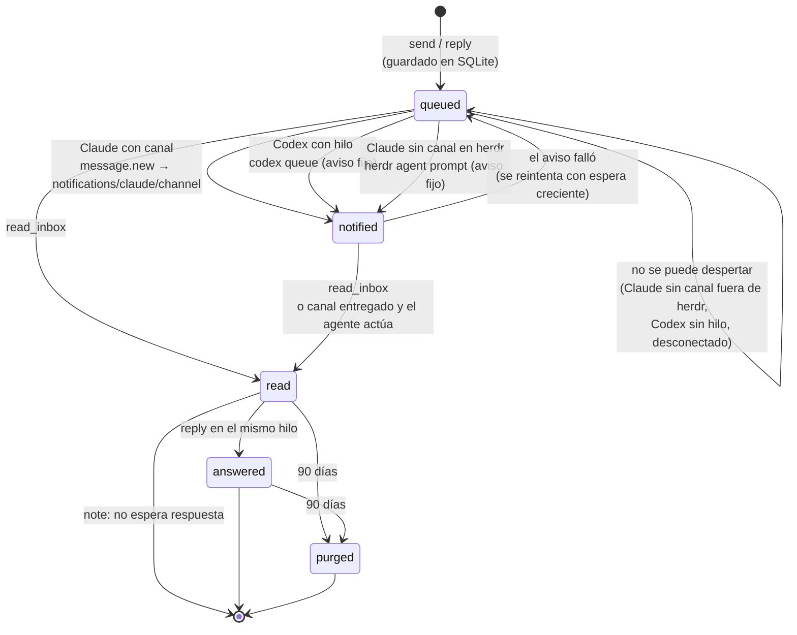
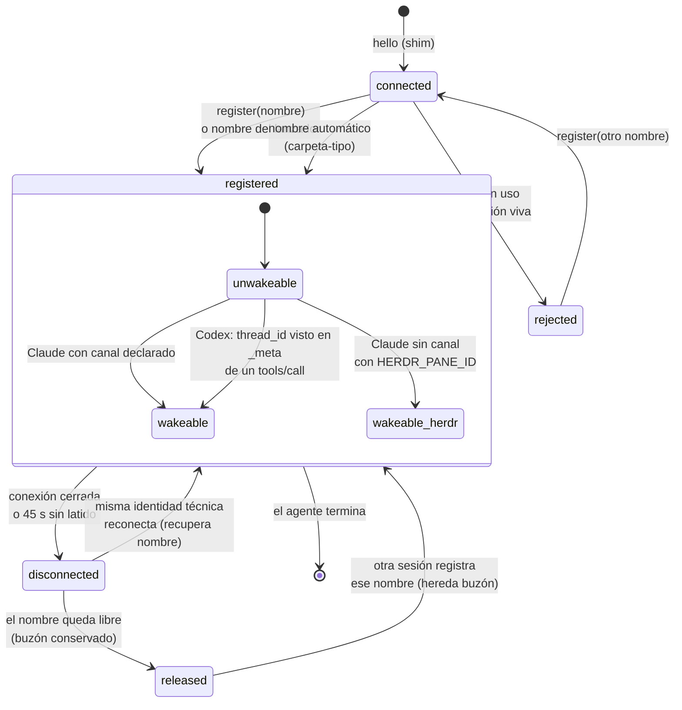
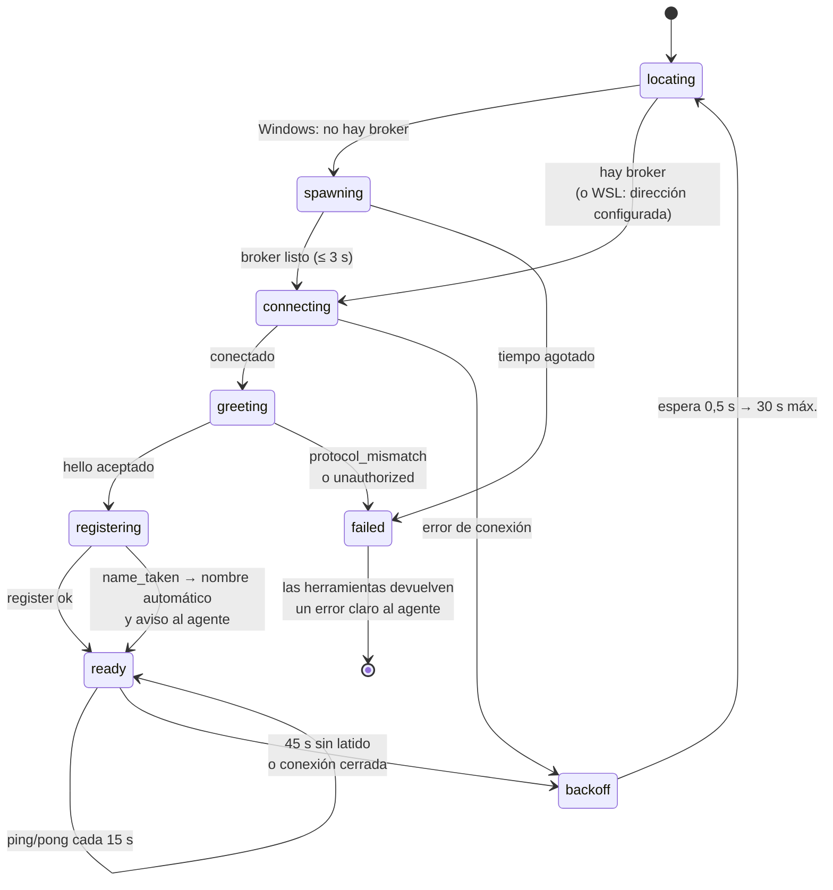
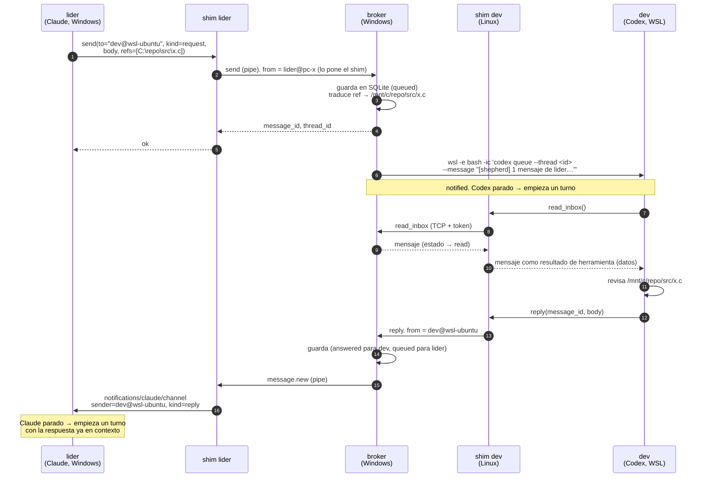

# Bus de mensajes: diagramas

Diagramas de estados y de secuencia de la fase 1. Las decisiones que reflejan están en `docs/adr/0001` a `0007`.

## 1. Ciclo de vida de un mensaje (por destinatario)

Cada destinatario de un mensaje tiene su propio estado (ADR-0006). El aviso depende del tipo de agente (ADR-0002).

Notas:

- Si llegan varios mensajes a un Codex antes de que lea, se agrupan en un único aviso.
- Una `request` en `read` sin respuesta aparece como pendiente en `status` y `list_agents`.
- Los mensajes no leídos (`queued`, `notified`) no caducan.

## 2. Sesión de un agente vista por el broker

## 3. Conexión del shim con el broker

Igual por named pipe (Windows) y por TCP (WSL), según ADR-0005.

## 4. Secuencia: lider (Claude en herdr, Windows) pide una revisión a dev (Codex en WSL)

